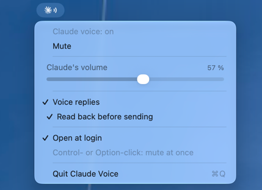

# Claude Code Voice



Claude Code speaks when it needs you. You can answer out loud.

- **One voice at a time.** Several sessions queue instead of talking over each other.
- **Claude's own volume.** A slider for Claude only, never the Mac's volume.
- **Voice replies.** Claude asks "Reply?"; say yes, dictate, hear it read back, say "send".
- **Mute** from the menu bar, Control Center, or `/voice-alerts:mute`.

macOS 26 or later. Not affiliated with Anthropic.

## Install

```
curl -fsSL https://raw.githubusercontent.com/hdavid/claude-code-voice/main/install.sh | sh
```

Installs the plugin into `~/.claude` and the app into `~/Applications`. Run again to update.
Other config folders: `sh -s -- --config-dir ~/.claude-work`.

## Use

- **Click** the icon: the menu. **Control- or Option-click**: mute at once.
- **Voice replies**: switch on in the menu. macOS asks once for the microphone and speech recognition.
  Recognition runs on the Mac.
- **From a shell**: `touch ~/.claude/voice-muted` mutes, `echo 40 > ~/.claude/voice-volume` sets 40 %.

## Build

```
brew install xcodegen && ./build.sh
```

Put your signing identity in a git-ignored `Local.xcconfig` (see `Signing.xcconfig`).

MIT licence.
